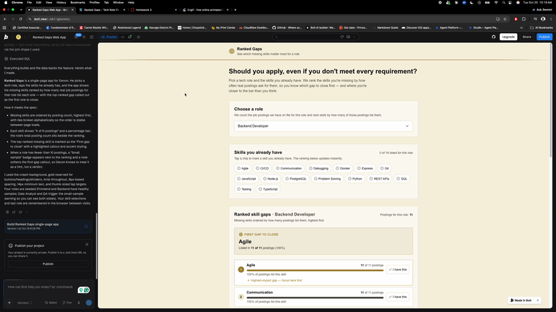
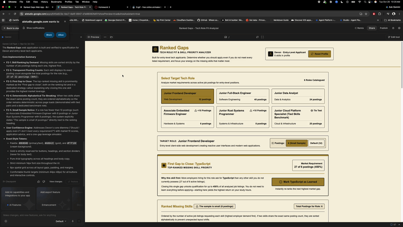
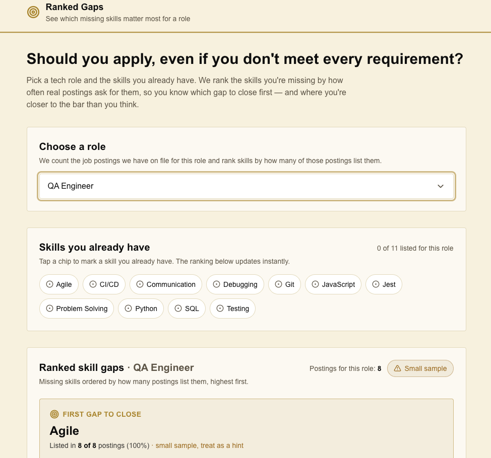

# HW6: Two Builders, One Specification

## Feature

**Exception:** `context/STYLE.md` and `context/SKILLS.md` are from my HW5 because the team's Phase 2 versions are not merged. The rest of `context/` is from the pinned commit.

**Team repository:** https://github.com/aaronsarasota04/mgt3745-team-gamma
**Spec provenance:** copied from commit `5abbc1c5509800ce9898e9935eafdf94cf694cc0` on 2026-10-19

**Feature:** F2. Ranked Gaps

- F2-1. THE SYSTEM SHALL order the missing skills by the number of postings for the role that list each one, highest first.
- F2-2. THE SYSTEM SHALL show the posting count beside each skill and the total postings for the role.
- F2-3. WHEN results are shown, THE SYSTEM SHALL mark the top-ranked missing skill as the first gap to close.
- F2-4. IF two skills have the same count, THEN THE SYSTEM SHALL order them alphabetically, so the order does not change between page loads.
- F2-5. IF the role has fewer than 10 postings, THEN THE SYSTEM SHALL say the sample is small next to the ranking.

## See It Work

| bolt.new | AI Studio |
|---|---|
|  |  |

bolt.new showing the small-sample note on a role with fewer than 10 postings:



## Status

bolt.new satisfied 5 of 5 EARS rows and AI Studio satisfied 4 of 5, because F2-2 was Partial (the "6 (Small Sample)" toggle showed "27 of 6 postings (450%)"). Recommendation: use AI Studio for F2 in Phase 2 with X4, X5, and X6 in the prompt. It scored 74 to bolt.new's 61, and the result flips without the credentials criterion.

## How to Run the Evals

```bash
npm test
```

`npm test` runs `evals/shared.test.js`, which calls the ranking logic copied from each build with the same inputs. It checks F2-1 (order by posting count) and F2-4 (alphabetical order for ties, and the same order whatever order the input arrives in). Expected output: 6 tests, 6 passing.

## Links

- [EVALS.md](EVALS.md): Prediction Stake and error log
- [COMPARISON.md](COMPARISON.md): evidence, spec gaps, and recommendation
- [JUDGMENT.md](JUDGMENT.md): judgment eval and agreement rate
- [prompts/PROMPT.md](prompts/PROMPT.md): the exact input both builders received
- [builds/](builds/): bolt.zip and aistudio.zip
- [docs/DDR-001.md](docs/DDR-001.md) (bolt.new), [docs/DDR-002.md](docs/DDR-002.md) (AI Studio), [docs/DDR-003.md](docs/DDR-003.md) (Claude)
- Team issue proposing FEATURES.md changes: https://github.com/aaronsarasota04/mgt3745-team-gamma/issues/15

## Hours

10 hours: 3 setup and stake, 2 builds and recordings, 2.0 evaluation, 2 weights and memo, 1.0 DDRs and README

## AI Use

- bolt.new built one version of F2 from the shared prompt. [docs/DDR-001.md](docs/DDR-001.md)
- Google AI Studio built the other version from the same prompt. [docs/DDR-002.md](docs/DDR-002.md)
- Claude drafted the README, the prompt, the shared test and adapters, the error log, COMPARISON.md, the team issue, and the DDRs from evidence I gathered. I chose the predictions, the weights, and the second grader, and I checked each draft against the recordings and code. [docs/DDR-003.md](docs/DDR-003.md)